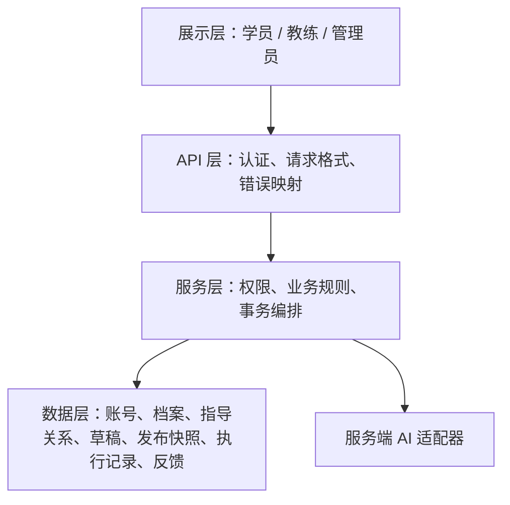

# FitNourish MVP1 架构基线（提议）

依据 [MVP1 v1.0](../spec/mvp1-scope.md)、[项目上下文](../context.md) 和九份模块规格。本文给第 9 周拆任务提供接口及依赖边界，待团队评审后冻结。框架、数据库和 AI 服务商沿用 [技术栈候选](../adr/001-technology-stack.md) 的待定状态。

## 模块边界

| 模块 | 职责与数据所有权 | 边界 |
| --- | --- | --- |
| [M01](../spec/module-01-account-and-permission.md) | 登录、退出、会话和角色识别 | 指导关系由 M02 判定 |
| [M02](../spec/module-02-profile-and-relationship.md) | 档案、生效指导关系 | 建立关系的业务流程待确认 |
| [M03](../spec/module-03-fitness-training.md) | 公共动作查询、训练草稿、发布快照与历史 | 生成交给 M04，执行记录归 M06 |
| [M04](../spec/module-04-ai-workout-builder.md) | 请求 AI、校验训练草稿、提供人工编写入口 | 合格结果交 M03，发布规则统一由 M03 执行 |
| [M05](../spec/module-05-nutrition.md) | 饮食草稿、确认发布、饮食版本 | 执行记录和反馈分别由 M06、M07 管理 |
| [M06](../spec/module-06-execution-record.md) | 训练、餐食文字、体重记录 | 引用发布版本，完成率由 M08 计算 |
| [M07](../spec/module-07-communication-feedback.md) | 围绕执行记录提问和反馈 | 以 M06 记录为锚点 |
| [M08](../spec/module-08-progress-view.md) | 完成率、体重趋势、历史聚合 | 对来源模块只读 |
| [M09](../spec/module-09-admin-basics.md) | 管理账号、角色与公共动作资料 | 管理权限不包含教练和学员私人数据 |

## 四层与依赖方向

展示层通过 API 获取数据。API 层提取当前会话身份并调用服务。服务层判断角色和资源权限、执行状态流转。数据层提供读写和事务，不调用上层。同层模块调用按[依赖图](dependency.md)执行。M08 负责组合训练历史及执行记录。M03 的历史接口若需组合 AC-03-08 所要求的记录，由 API 层调用 M03 和 M06 的授权查询后按版本 ID 组合，M03 服务不反向调用 M06。

## 核心接口契约

下列路径和错误码是本周评审提案。所有请求使用 JSON，身份从有效会话取得。错误响应统一为 `{"code":"…","message":"…","details":{}}`。403、404 响应不含计划字段或私人数据。草稿及发布条目包含 `trainingDate`、`exerciseId`、`sets`、`reps`、`suggestedWeight`，其中日期为 YYYY-MM-DD，组数和次数为正整数，重量表示方式待团队确认。

| 接口 | 请求 | 成功响应 | 失败响应 |
| --- | --- | --- | --- |
| M04 生成训练草稿 `POST /api/trainees/{traineeId}/training-drafts/generate` | `{weekStart, coachNotes?}`，档案由后端查询 | 201 `{draftId, traineeId, status:"draft", source:"ai", items}` | 400 `INVALID_REQUEST`，401 `UNAUTHENTICATED`，403 `FORBIDDEN`，422 `PROFILE_INCOMPLETE` / `AI_DRAFT_INVALID`，503 `AI_UNAVAILABLE`，504 `AI_TIMEOUT` |
| M03 确认发布 `POST /api/trainees/{traineeId}/training-drafts/{draftId}/publish` | `{expectedRevision}`，来自教练正在审阅的草稿版本 | 首次 201 `{planVersionId, draftId, traineeId, status:"published", confirmedBy, confirmedAt, items}`，同一已提交修订重试返回 200 和原快照 | 400 `INVALID_REQUEST`，401 `UNAUTHENTICATED`，403 `FORBIDDEN`，404 `DRAFT_NOT_FOUND`，409 `REVISION_CONFLICT` / `DRAFT_STATE_CONFLICT`，422 `TRAINING_DATE_REQUIRED` / `EMPTY_PLAN` / `EXERCISE_UNAVAILABLE` |
| M03 学员查询 `GET /api/me/training-plans[/{planVersionId}]` | 会话身份及可选版本 ID | 200 发布快照列表或单个快照，列表无数据时返回 `[]` | 401 `UNAUTHENTICATED`，403 `FORBIDDEN`（角色不符），404 `PLAN_NOT_FOUND`（版本不存在、属于他人或草稿 ID） |

查看/编辑草稿契约待后续任务细化，须返回当前修订号，任何成功编辑递增修订号。失败详情包含可解释的字段或动作 ID。生成失败时界面提供人工编写入口。离线样例单独标为模拟数据，不能返回上述真实生成 201 或写入可发布记录。

| 契约检查 | Spec |
| --- | --- |
| 生成前检查授权，成功只建草稿，校验失败和服务故障无草稿 | AC-04-01/02/03/04/07；模拟与人工路径 AC-04-08/09 |
| 发布只允许负责教练，记录确认人和时间，缺日期、空动作、停用动作均拒绝 | AC-03-01/02/03/04/07、AC-04-05 |
| 学员只见自己的已发布快照，新周期不覆盖历史 | AC-03-05/06、AC-08-07、AC-09-08 |

## 成功与失败的数据流

1. M04 先核对会话、指导关系和档案，再由后端调用 AI。结构和器械条件校验通过后，调用 M03 创建草稿。校验或服务失败不写可用草稿、不改变已发布计划；无权限时不会发起 AI 调用。
2. 教练审阅草稿后提交发布。M03 在事务内核对修订、草稿状态、必填项和动作有效性，并将确认信息、动作快照及发布版本一并提交。失败时回滚，草稿和历史均保持原状态。
3. 同一草稿修订的发布请求重试返回原快照。并发修改导致修订不符时返回 409，教练重新加载再确认。下一周期从新草稿发布，新版本不覆盖旧版本。M06 记录引用当时的版本，M08 据该版本计算历史完成率。细节见[发布 ADR](../adr/002-training-plan-publication.md)。

## 拟冻结范围

评审通过后冻结模块边界、依赖方向、上述公开契约、核心数据实体及已接受的 ADR。UI 布局、内部函数命名、框架小版本和索引调优随实现迭代。接口或依赖变更须更新相关文档并以 ADR 留痕。下一周可按会话/关系读取、草稿生成、事务发布、已发布查询拆分，各自引用本页契约和模块 AC。
