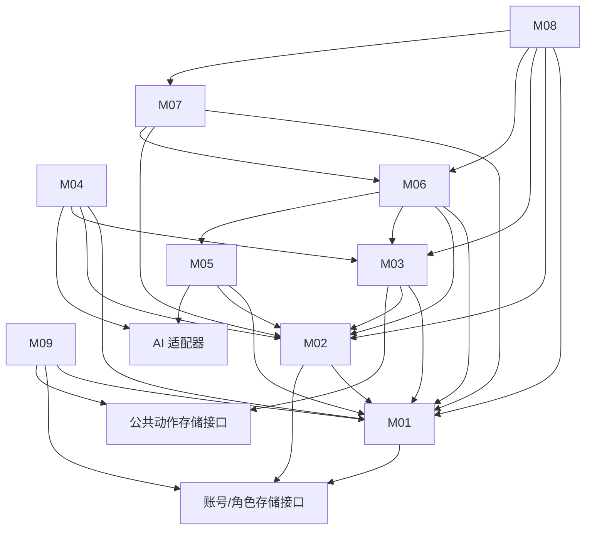

# MVP1 依赖与风险

依据 [架构基线](architecture.md) 和 [MVP1 v1.0](../spec/mvp1-scope.md)。箭头表示服务调用或读取接口，指向被依赖方。聚合 API 同时读取多个模块时，各服务保留自身鉴权。

- **M01 / M02 / M09**：M01 和 M02 通过窄接口读取账号状态和角色。M09 管理端调用 M01 校验管理员角色。负责教练的判定由业务服务组合 M01 的身份和 M02 的指导关系，M01 不调用 M02。
- **M05 / M06 / M07**：M06 引用 M05 发布的建议版本，M07 以 M06 记录为锚。需要在营养视图中显示记录或反馈时，API 层汇总三方查询，M05 的发布事务只写建议数据。
- **M03 / M06**：历史计划及对应记录由 API 层组合。M06 可以读取已发布计划，M03 不调用 M06。M08 同样按版本读取。
- **分层约束**：展示层只访问 API；服务通过数据接口访问存储；AI 只由服务端调用。依赖和契约变更通过 ADR 评审。

## 风险登记

负责人以拟分工角色列出，具体成员由小组确认。探针验收见 [计划](spike/plan.md)。

| 风险 | 影响 | 应对 | 拟负责人 | 验证 |
| --- | --- | --- | --- | --- |
| 同一草稿并发确认或确认时草稿已改 | 重复发布或发布错版本 | 事务、条件更新、唯一约束、冲突提示 | M03 后端负责人 | S03 并发、重试、编辑交错 |
| 新周期覆盖旧计划或建议 | 历史、完成率计算错误 | 不可变快照及稳定外键 | 数据层负责人 | S03 查询历史与完成率 |
| 错把前端隐藏当权限检查 | 私人数据泄漏或异常 AI 调用 | 直接请求仍经会话及关系检查 | M01/M02 后端负责人 | S02 对照允许和拒绝路径，核对零副作用 |
| AI 结构合法但字段缺失或动作不适用 | 错误草稿进入发布流程 | 服务端校验及人工入口 | M04 后端负责人 | S01 候选服务与固定坏样例 |
| 前后端错误码与 Spec 分歧 | 错误界面或误报成功 | 契约示例、按 AC 核对状态和响应 | API 与前端负责人 | S04 mock 几种关键响应 |
| 技术栈未定，目标数据库事务语义不一致 | 竞态设计实际不可用 | 候选环境运行 S03 并记录锁等待与重试 | 数据层负责人 | 每个候选数据库分别记录结论 |
